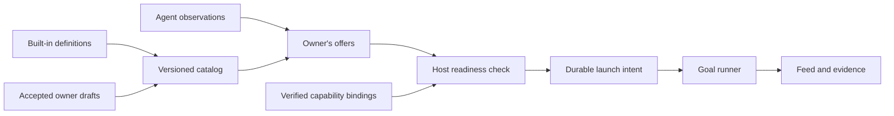

# Task catalog and runnable recommendations

## Outcome

The person can browse useful work, choose a recommendation, and start it from the card. A ready
recommendation starts one background task immediately. If a required account, permission, choice, or
input is missing, the card asks for that exact prerequisite and resumes the same request when it is
ready. Choosing a recommendation authorizes an attempt, not every action the task might take.

This is a design for capabilities that can be connected over time. A card must never imply that a
service or action works before the host has verified it. The catalog is useful without any hosted
recommendation service or third-party intermediary.

## Distinct records

| Record | Meaning | Ownership and lifetime |
| --- | --- | --- |
| **Task definition** | A reusable, versioned promise of work, its required inputs and capabilities, permitted kinds of effect, and how success is checked. | Product definitions ship with the app; owner-installed definitions live in owner state. A published revision is immutable. |
| **Offer** | A reason this definition is relevant to this person now, with optional prefilled inputs and source references. | Owner state. It can be accepted, dismissed, expired, or superseded without changing the definition. |
| **Launch intent** | The person's one request to run an exact definition revision with exact inputs. | Owner state from click through setup, execution, and recovery. It has one idempotency key and one eventual goal. |
| **Run evidence** | The resulting goal, actions, approvals, source receipts, and outcome. | Existing goal and Feed stores, linked to the launch. |

Definitions and offers are different from `Ideas` and `Cases`. An Idea is a thought that waits for
the person; a Case is an agent-owned matter already being worked. Either may produce an offer, but
neither becomes an executable definition merely because it mentions a task. Existing Goals remain the
execution record, not the catalog.

### Definition contract

A definition has a stable ID and revision; a plain-language title, category, and expected result;
typed required inputs and safe defaults; semantic capability requirements; an effect ceiling; a
completion-evidence rule; and an execution mode. The execution mode is a one-shot Goal by default.
Recurrence is a separate, explicit owner choice. The definition contains no credentials, personal
data, provider token, or text copied from a tool response as instructions.

Capabilities describe operations such as searching a connected source or drafting an action, not
arbitrary MCP tool names. A host-maintained binding maps each operation to an adapter, account, exact
tool, argument boundary, and effect classification. A server's tool description and `readOnly` hint
are untrusted claims; they cannot create a binding or lower its effect class. A definition that needs
an unverified operation is visible as unavailable, never marked ready.

Built-in definitions are reviewed with the product. The person may save a successful task as a draft
definition and accept it for later use. The agent may propose drafts or attach a trusted definition
to an observation, but it cannot publish a draft, grant a capability, or start an offered task on its
own. A future shared catalog would be an optional import path with its own review and provenance;
local and self-hosted operation cannot depend on it.

### Offer contract

An offer references a definition ID and revision, its source (`built-in`, `owner`, or `agent`), a
short reason, bounded context references, creation and expiry, and the owner's decision. A stable
deduplication key prevents repeated observations from filling the page with copies. Prefilled values
are suggestions, not authority; the person can inspect and change them. Source text from a mail,
page, or connector is displayed as data and is never promoted into definition instructions.

The catalog can begin with locally bundled definitions and an editorial order. Later, accepted
agent observations, saved successful work, and owner choices can fill the offer store. Ranking can
use relevance and readiness, but dismissal and privacy controls belong to the person. Request counts
measure interest; only independently checked outcomes count as completed work. Personal activity
stays in owner state unless the person explicitly opts into aggregation.

## Readiness and launch

The host computes readiness when the page is shown and again when the person presses **Start**. It
checks definition revision, required input, connected account identity, live credential state,
granted scopes, the person's per-tool decisions, installed browser or other local capabilities, and
the binding's effect policy. The result is one of:

- **Ready:** show the expected result, source/account, and kinds of access before the person starts.
- **Needs setup:** identify the missing input, account choice, sign-in, or permission, and take the
  person directly to that step. More than one eligible account requires an explicit choice.
- **Unavailable:** explain the missing capability or service support and keep **Start** disabled.

Pressing **Start** creates or retrieves a durable launch intent before any Goal is created. The
client supplies an idempotency key; the server also serializes acceptance of one offer so double
clicks and retries return the same launch. The intent holds the immutable definition revision,
resolved input values, selected account and capability bindings, offer origin, and owner identity.
It stores references to credentials, never their values.

If setup is needed, the intent waits. After sign-in or input, the host refreshes readiness and
resumes that intent automatically while the person's request is still current and unchanged. A
failed or abandoned setup stays pending or expires with a clear status; it does not silently start
later after authority has changed. If a permission, account, definition, or prefilled value changes,
the host asks the person to review the changed request before starting.

When ready, the coordinator attaches the launch ID to a new one-shot Goal and asks the existing
runner to start it. The link is typed metadata, not a string hidden in the Goal prompt. Reserving
the intent and recording that ID on the Goal allow recovery to find a Goal created just before a
crash and avoid creating a second one. A new definition revision never changes a running Goal.

During execution the host limits the session to the bound capabilities. For a connector operation,
the exact connector, tool and allowed argument shape are checked again at final dispatch. Revoked
access pauses or fails the task with an explanation. The existing approval gate still holds each
consequential action; a card click or OAuth consent never approves sending, purchasing, publishing,
or other consequential effects. Denial leaves that action unperformed and is reported in the Feed.

The card opens the linked Goal immediately after launch. The Goal and Feed show progress, waiting
setup or approval, cancellation, partial results, and failure. A model's final message is a report,
not proof of completion: the definition's evidence rule must be satisfied by a source readback,
receipt, or another independently checked result. Work without that evidence is reported as
unverified, not counted as complete.

## Product boundaries

The personal-agent composition root owns built-in definitions, owner-state stores for definitions,
offers and intents, capability bindings, readiness, and launch coordination. A file adapter can
persist these under the owner-only state directory's `task-catalog/`; a storage port leaves room for
another host adapter. The private web UI provides a Browse view, card details, setup, and the linked
Goal/Feed journey through the existing owner-authenticated API. Browse can group definitions by
category and show the person's offers separately. An "often chosen" group requires an actual,
privacy-controlled aggregate; it must not show request counts as verified successes. Connector
discovery remains about *services*; it is not the task catalog.

The personal capability pack continues to own reusable Goal, Idea, Case, connector, and approval
contracts. Extend a neutral contract only where the launch needs a typed origin or a dispatch fence
that another product could use. Do not move the catalog's product choices into the SDK in advance.
The same owner-state and host contracts work in local and self-hosted modes.

## Delivery checks

Build this in independently verifiable pieces: persist and browse definitions and offers; resolve
readiness from verified bindings; start a one-shot Goal exactly once; preserve an intent through
setup and restart; then add evidence-backed outcomes and personalized ranking. The Browse view can
arrive before every connector family, but only ready definitions offer **Start**.

Before calling the flow complete, verify these behaviors with real host boundaries:

- A ready offer starts one Goal on a double click, returns that Goal after a retry or restart, and
  links its report and evidence back to the offer.
- Missing sign-in, input, or account choice resumes the same intent after completion; a revoked
  scope, changed account, or expired intent cannot launch under old authority.
- A changed definition revision leaves an active run intact. A denied action produces no external
  effect. Untrusted connector metadata or source content cannot widen the task's tool set.
- A run without source evidence is not marked completed. Local and self-hosted modes expose the same
  journey, with owner-only storage and no remote catalog dependency.
