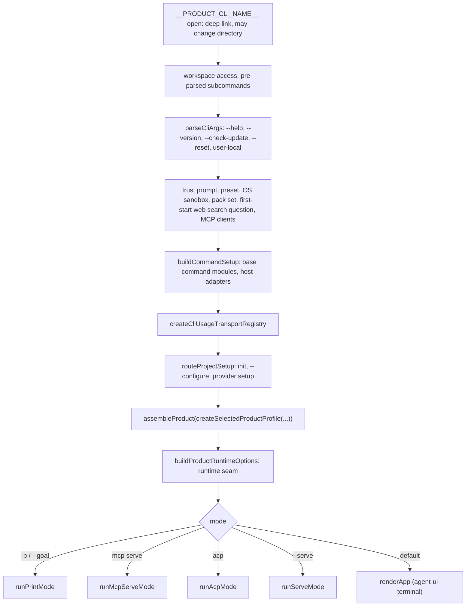

# agent-cli — composition and transport registry

> Whitebox design for `@robota-sdk/agent-cli`. The blackbox contract lives in
> [`../SPEC.md`](../SPEC.md); nothing here is a promise to a consumer.

## Context & Goal

How one `__PRODUCT_CLI_NAME__` run turns resolved settings into an assembled product, binds it to a mode, and
registers transports. The user sees only the resulting behaviour; which function builds what, and in
which order, is internal.

The shell is `startCliCore()` in `src/cli-core.ts`. It reads arguments, settings and the environment,
then calls the product-neutral `assembleProduct()` from `@robota-sdk/agent-product` once, with __PRODUCT_CLI_NAME__'s
identity declared as data in `createSelectedProductProfile()` (`src/product/product-profile.ts`).
`startCliEntry()` (`src/cli-entry.ts`) wraps it for an executable: it installs the diagnostics sink and
the crash policy, then calls `startCli()`, which supplies the terminal presentation.

## Constraints

- `assembleProduct()` never branches on a product, provider or transport name. Everything that makes
  the product __PRODUCT_CLI_NAME__ is data in the profile.
- The shell resolves the preset once (`resolveShellPreset()` in `src/startup/preset-selection.ts`) and
  hands that registry to the profile; `assembleProduct()` adopts it instead of building a second one.
- Concrete transports are chosen by the shell, never by the assembler.
- The headless entry never imports the terminal UI. `startCliCore()` takes the presentation as an
  optional `ICliPresentation` value, and only `startCli()` in `src/cli.ts` supplies it.

## Internal Structure

### Entry points

| Entry                 | What it does                                                                                                      | Used by                                  |
| --------------------- | ----------------------------------------------------------------------------------------------------------------- | ---------------------------------------- |
| `src/bin.ts`          | Hardens the process, then `startCliEntry()` → `startCli()` → `startCliCore(options, host, runners, presentation)` | The `__PRODUCT_CLI_NAME__` binary        |
| `src/headless-bin.ts` | `startCliCore({ productRuntime }, host, runners)` with no presentation; accepts only `--serve`                    | The desktop app's headless runtime build |
| `src/index.ts`        | Exports `startCli`, `startCliEntry`, `createProductCliHost`, `IStartCliOptions` and the hosted-execution API      | Code that embeds the CLI                 |
| `src/product-host.ts` | `createProductCliHost()`: binds one consumer executable to a fixed product identity (`./host`)                    | A separate product built on the CLI      |
| `src/desktop-host.ts` | The desktop controller for trust admission, daemon start and the loopback endpoint (`./desktop-host`)             | A consumer's Electron main process       |

`startCli()` and `headless-bin.ts` check for the subagent worker flag first and, when present, run
`runSubagentWorkerMain(createProductSubagentComposition())` instead of the CLI (see
[`subagent-wiring.md`](subagent-wiring.md)).

### Startup order

The operator can select hosted posture through `__PRODUCT_ENV_PREFIX__RUNTIME_POSTURE=hosted` and the absolute
`__PRODUCT_ENV_PREFIX__HOSTED_RUNTIME_CONFIG` path. The owner-controlled deployment file contains public
attestation pins and workload identity, never a worker management or issuer private key.
`startCliCore()` admits both the worker and broker before entering the local startup chain below.
Their Ed25519 proofs bind a fresh challenge to the tenant, task and root task, actor, runtime,
backend resource, current policy epoch, expected snapshot digest and the configured limits (the
broker's also its cumulative usage). Both must remain valid after the slower response arrives. Redirects, missing proofs, unavailable backends, stale epochs and corrupt resume state
refuse execution. A configured deployment cannot be downgraded through a local/disabled value.

Hosted execution requires an executor: the embedding operator's `hostedRuntimeExecutorFactory`, or,
when `__PRODUCT_ENV_PREFIX__HOSTED_WORKER_EXECUTION_CONFIG` is set, the stock executor from
`createE2BHostedRuntimeExecutorFactory()` that runs the CLI inside an admitted E2B worker (it loads
the optional `e2b` package). The returned executor owns the full session/mode composition and
worker/broker teardown. The controller gives it an abort signal and a cumulative usage observer,
rechecks current admission, and stops it on lost authority or lifetime expiry. The factory owns any
partial allocation until it returns the executor; cancellation or failure must clean that
allocation. Failed or timed-out teardown remains a failure even if a late result can subsequently be
released.

With neither executor, even valid proofs refuse hosted execution; an admitted hosted run never
reaches the ordinary host tool composition. The existing personal local path remains available only
when no hosted deployment is configured.

Pre-parsed subcommands (`doctor`, `trust`, `daemon`, `--attach`, `session …`, `secure`, `usage`,
`mcp add|login|logout`, `eval`) are routed by `runPreparsedCliCommand()` in `src/startup/preparsed-command-routing.ts` and
return before the product is assembled. See [`internal-structure.md`](internal-structure.md).

### Command modules

Built-in commands are `ICommandModule` instances injected into the session. A command module owns its
metadata and returns structured results; the session executes any host actions a result carries
through `ICommandHostAdapters`.

1. `buildCommandSetup()` (`src/startup/command-setup.ts`) calls `createDefaultCommandModules()` from
   `@robota-sdk/agent-product/command`, with the names the packs supply disabled.
2. `createProductPackSet()` (`src/product/subagent-composition.ts`) builds the packs from
   `createProductCapabilityPacks()`. __PRODUCT_DISPLAY_NAME__ composes one pack, `createCodingPack()` from
   `@robota-sdk/agent-product/coding`, which supplies the `/shell`, `/editor` and `/git` modules, the coding tools and the coding subagents.
   Dropping the pack from the profile drops all of them.
3. `assembleProduct()` merges base and pack modules additively. A colliding id is rejected, not
   overridden, and the shell reports it (`Capability … was not composed`).
4. `selectProductCommandModules()` (`src/product/runtime-plumbing.ts`) applies the preset's
   `enabledCommandModules` / `disabledCommandModules` to that merged set, then appends the fixed
   modules the preset never filters: `/workflows` from `@robota-sdk/workflows/command` (the pinned
   external `@robota-sdk/workflows` release, bundled into the CLI) and any `commandModules` a caller
   passed to `startCli()`.

Preset module names that match nothing are reported by `reportUnknownPresetModules()` before
`init` and `--configure` can return early.

### Tool surface

The packs own __PRODUCT_CLI_NAME__'s tools. `buildProductRuntimeOptions()` passes `PACKS_OWN_TOOL_SURFACE`
(an empty list) as the session's `defaultTools`, which replaces agent-framework's own default tool
tier; the kernel then adds each pack's tools to `additionalTools`. The pack file tools are scoped to
the `cwd` they are built with, so the shell builds the packs before command setup. MCP tools and the
advisor tool are appended to `additionalTools` afterwards.

### Runners and the subagent factory

The shell builds the background-task runners (`createDefaultBackgroundTaskRunners()` from
`@robota-sdk/agent-executor/node`) and the subagent runner factory (`createProductSubagentRunnerFactory()`),
passes them into the profile, and reads them back from the assembled product with
`bindAssembledCollaborators()`. Every mode receives the instances the product holds.

### Transport registry

`createCliUsageTransportRegistry()` (`src/usage/usage-transport-registry.ts`) wraps
`createDefaultTransportRegistry()` in `src/product/runtime-plumbing.ts`. That function creates:

- a `TransportRegistry` — the class belongs to `@robota-sdk/agent-framework` — whose saved
  enable/option state lives in the `transports` section of the user settings file;
- a `WsTransport` from `@robota-sdk/agent-transport/ws`, which takes an optional launch token and
  port from `__PRODUCT_ENV_PREFIX__WS_TOKEN` / `__PRODUCT_ENV_PREFIX__WS_PORT` (a supervised daemon's token instead arrives on a pipe
  its launcher inherited) and removes the token from the environment;
- when `--serve --observer-port` is given, a second `WsTransport` with the `observe` role, on the
  requested port and with the operator's `__PRODUCT_ENV_PREFIX__OBSERVER_TOKEN`;
- `bindTransports(session)`, which binds the WebSocket transport to a session with
  `bindTransportAdapter()` and registers it, or replaces the earlier binding after a session switch,
  and binds the observer transport after it.

| Transport                     | Registered by                                                   | Started by                                                    |
| ----------------------------- | --------------------------------------------------------------- | ------------------------------------------------------------- |
| `WsTransport` (`ws`)          | `bindTransports()` when a session binds                         | `startAll()`; enabled by default                              |
| `WsTransport` (`ws-observer`) | `bindTransports()` when `--observer-port` is given              | `startAll()`, after `ws`; not listed or saved by `/transport` |
| `WebRtcTransport` (`webrtc`)  | the remote-control controller when `/remote-control` is enabled | the controller itself; not enabled by default                 |

Each mode receives the registry:

- **TUI** — `renderApp()` passes it to every `TuiInteractionChannel`, which calls `bindTransports`
  and then `startAll()` when it starts, and `stopAll()` when it stops.
- **`--serve`** — `runServeMode()` hands it and `bindTransports` to `startRuntimeHost()` from
  agent-framework.
- **Print mode** — no transports.

The CLI does not own WebSocket protocol framing. With `--serve --open` it serves the GUI web app
(built from `packages/agent-gui-web` and copied into `dist/web`) on a separate localhost server and
points it at the WebSocket port; the transport itself serves no UI.

### Exit and other host actions

`/exit` comes from `@robota-sdk/agent-product/command`. Its result carries a `session-exit` host action; the
session runs it through `commandHostAdapters.process.requestExit()`. In TUI mode the shell installs
`createTuiProcessAdapter()` (`src/startup/host-action-adapters.ts`), which sends the process a
`SIGTERM` shortly afterwards so the TUI shuts down through its normal signal path.

`/plugin` and `/reload-plugins` also come from agent-product/command. The CLI supplies only the
`ICommandPluginAdapter` implementation (`src/plugins/default-plugin-command-adapter.ts`) and the
plugin command-source loader; the terminal UI opens the plugin screen and reloads the registry.

## Key Flows

Settings → base command modules → `assembleProduct(createSelectedProductProfile(…))` → preset delta → runtime
options → mode → session construction → transport binding. What the user can observe of this chain
is specified in [`../SPEC.md`](../SPEC.md).

## Test Approach

`src/__tests__/product-assembly-equivalence.test.ts`, `product-runtime-seam.test.ts` and
`cli-command-composition.test.ts` cover the fold, the runtime seam and the module selection;
`src/product/__tests__/assembled-collaborators.test.ts` covers the collaborator identity.
