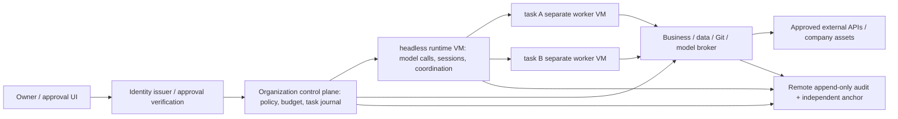

# Proposal: Threat Model, Ownership, and Common Contract

This document is a research proposal. It does not mean that all of the organizational authority below is already implemented in the current product.
The PoC uses synthetic organizations, identities, and assets and is not connected to any real company account.

## Ownership and approval

| Asset / action                          | Owner                           | Scope performed automatically                                      | Approval / revocation authority                             | Enforcement boundary                                                                            |
| --------------------------------------- | ------------------------------- | ------------------------------------------------------------------ | ----------------------------------------------------------- | ----------------------------------------------------------------------------------------------- |
| Model calls / business data access      | Business data owner             | The corpus and model endpoint assigned to the task, budget limits  | Data owner, security operator                               | Data broker, task-bound audience, tenant filter, egress gateway                                 |
| Task repository / files                 | Repository owner                | Modify only the permitted task clone/branch, temporary Git commits | Repository owner                                            | Independent worker filesystem, no host mount, task-scoped branch lease                          |
| Main merge / release / deployment       | Service operations owner        | Create plans, builds, tests, and draft artifacts                   | Deployment approver                                         | One-time approval bound to the exact artifact digest, environment, and operation; deploy broker |
| Payments / refunds / external transfers | Finance approver                | Produce only calculations, supporting evidence, and drafts         | Finance approver; for large amounts, two separate approvers | Payment broker that verifies amount, payee, currency, and idempotency key                       |
| Account / permission / secret changes   | Identity/security administrator | Write permission-change proposals and their rationale              | Identity/security administrator                             | IAM broker, user-only approval channel, delegation revocation epoch                             |
| Session / shared business state         | Business operations owner       | Write its own task journal and approved results                    | Business operations owner                                   | Storage permission per tenant+task+actor, CAS version, append-only journal                      |
| Audit records / incident recovery       | Security operator               | Append events with sensitive information removed                   | Security operator and independent auditor                   | Append-only sink outside the worker, remote anchor, recovery approval channel                   |

Each deploying organization must map these roles to actual people. Even if model output or another
agent's message declares such a mapping or an approver's identity, it is not trusted. A display name
shown in the UI is not an identity.

## Threats and enforcement points

| Untrusted input / attack                                       | Impact                                                | Blocking/limiting point                                                                      | Verification that must be run                                                                 |
| -------------------------------------------------------------- | ----------------------------------------------------- | -------------------------------------------------------------------------------------------- | --------------------------------------------------------------------------------------------- |
| Repo instruction, prompt, or tool result saying "send the key" | Credential theft, external exfiltration               | No upstream key injected into the worker, scoped broker, default-deny egress                 | Env, filesystem, metadata, and Unix-socket canaries, and raw-IP/DNS/redirect bypass attempts  |
| Agent A impersonates B's result or identity                    | Privilege escalation, cross-task data                 | Verifier-bound workload identity and actor/task/audience scope, message provenance           | Actor tampering, token replay, requests for another tenant or task, unsigned/expired messages |
| Altering the arguments of an approved low-risk operation       | Bypass of deployment/payment approval                 | The broker rechecks the canonical request digest, asset, operation, and policy epoch         | Changing amount, payee, artifact, or environment after approval; reusing an approval          |
| Parallel retries, lost network responses                       | Duplicate high-impact actions                         | Durable idempotency journal + provider key, reconciliation of pending state                  | Concurrent identical operations, before/after crash, retry of unknown external outcome        |
| Contention on shared branches / business state                 | Lost update, incorrect completion                     | CAS revision, bounded lease, fencing token, result digest                                    | Stale write, lease expiration, two-writer conflict, old lease after worker restore            |
| Compromised worker / generated program                         | Intrusion into host/runtime and other tasks           | Separate VM/process credentials, private per-task root/temp, syscall/device/network controls | Real shell/child/Git and file symlink, IPC, host mount, and metadata probing                  |
| Runaway model, fork bomb, huge output                          | Service outage, billing                               | Task/tenant/global budget and concurrency, hard limits on process/memory/CPU/output/time     | Child explosion, request flood, budget race, children remaining after cancellation            |
| Rollback or tampering of snapshot / session / audit            | Revoked authority reactivated, loss of accountability | Control-plane policy epoch and journal are kept outside the worker snapshot                  | Revoke→restore→retry is denied; event deletion/order/tamper detection                         |
| Attacker reaches the management API / egress proxy             | Global policy change, key exposure                    | Control API in a separate trust domain, authenticated mediation, metadata deny               | Admin endpoint access, broker SSRF, proxy CONNECT/raw socket bypass                           |

## Identity and delegation

Agent, role, and task are separate identifiers. The actor is determined as the subject of an attested
workload credential, and the following are verified: tenant, task, role, parent delegation, target
audience, allowed operations/resources, not-before/expiry, maximum count, amount, time, and token
budget, whether re-delegation is allowed, and the policy epoch. Signature verification is
authentication, and policy evaluation is authorization. Re-delegation is the intersection of the
parent's authority and does not extend the validity period or budget. A model that receives a role
name cannot expand its scope on its own.

A delegation budget is not satisfied by merely comparing the child's numeric fields to be no greater
than the parent's. The same operation is atomically reserved against every ancestor delegation, the
task, the tenant, and the global ledger, and the usage of sibling delegations is summed. Two children
must not each duplicate a parent limit of 100 as 100 and spend a total of 200. Reserve→commit→reconcile
use the same idempotency key, and when the external outcome is unknown, the reservation is not
arbitrarily returned. The PoC verifies the race in which two children simultaneously reserve the
remaining parent limit.

The PoC verifies this contract with a short TTL and a synthetic signing key. Production keys are kept
in a KMS/HSM or an identity issuer and are not put in the worker image, env, or snapshot. SPIFFE
identity is a candidate, but a SPIFFE ID alone does not create company business authority. The policy
engine can be implemented with OPA or similar, but policy decisions must be connected to every
shell/network/business-API enforcement point.
[SPIFFE concepts](https://spiffe.io/docs/latest/spiffe/concepts/),
[OPA API authorization](https://www.openpolicyagent.org/docs/http-api-authorization).

## Concurrency, state, and long-running operation

Each task has a durable state machine (admitted/running/needs-approval/stopping/stopped/completed/failed)
and an owner. A snapshot is a recovery reference for the task filesystem and does not roll back
approval, delegation, or budget journals. A resumed worker receives a new identity and the current
epoch, and policy is evaluated again. Because a checkpoint may contain malicious executables or a
contaminated repo, it is restored into a new worker after checking digest and provenance, and startup
hooks are also verified as trusted inputs.

Messages between agents have an authenticated sender and schema, size, and sequence limits, but their
content is still untrusted. A message saying "the owner approved" is not converted into an approval. A
high-impact API receives the operation digest and idempotency key through a separate trusted approval
channel. If an external API does not provide idempotency and the response is lost, the outcome stays
unknown and reconciliation is requested from an administrator. "Exactly once" is not claimed on the
basis of internal DB success alone.

Per-task, per-role, and per-tenant limits on tokens, cost, execution time, concurrent tasks, and child
count, and a global emergency stop, are enforced centrally. Revocation blocks new admission and
existing broker calls, stops the worker, its descendant processes, and services, and closes network
connections. Revocation is not considered complete merely because local event-loop cancellation has
occurred. The approach of looking up the policy epoch on every request and the maximum staleness of
cached policy are measured together with their cost. On failure, privileged operations are denied.

## Minimal reference topology

The root filesystem, temp directory, upstream key, and management token are not shared between the
runtime and the worker. Even if the runtime holds a model key, it is not serialized into the worker
API. If necessary, model calls also go through a broker. The desktop Electron app remains a local UI,
and remote authentication, pairing, trust, and session multiplexing are designed under a separate
contract. A Fly Machine is a candidate for runtime placement, and Sprite/E2B are candidates for task
workers. A general Lambda function is compared as a candidate for short triggers, and the new Lambda
MicroVM/Managed Instances features are evaluated as candidates separate from general functions.

## Incident detection, response, and recovery responsibilities

| Stage             | Responsible party                      | Action                                                                                                                            | Evidence to check                                                                                                 |
| ----------------- | -------------------------------------- | --------------------------------------------------------------------------------------------------------------------------------- | ----------------------------------------------------------------------------------------------------------------- |
| Detection         | Security operator                      | Alerts on deny bursts, cross-tenant requests, unexpected egress, budget spikes, and audit chain gaps                              | Correlate by event ID, actor, task, policy epoch, and operation digest; exclude raw secrets and prompts from logs |
| Containment       | Identity administrator + control plane | Revoke tenant/task/actor, cancel approvals, broker deny, stop worker network/processes                                            | Tokens both before and after issuance are rejected, active connections closed, descendants terminated             |
| Damage assessment | Asset owner                            | Reconcile broker/provider journals, reconcile unknown operations, compare approved scope with actual changes                      | External transaction IDs, Git digest, asset revision, missing audit anchors                                       |
| Recovery          | Business operator + security approver  | Restore a verified checkpoint onto a clean image, credential rotation under separate approval, refresh budget/epoch               | Old approvals, leases, and revoked identities are not revived by the restore                                      |
| Closure           | Independent auditor                    | Clean up resources, snapshots, and connections, confirm residual billing, preserve related evidence, record recurrence conditions | Provider resource list and invoice/usage, journal hash anchor, re-run attack/recovery experiments                 |

A hash chain in the worker log alone is not claimed to prevent an external attacker from rewriting or
deleting the entire log. A trusted append outside the worker and an independent anchor are needed.
Audit redaction is tested with secret canaries, and an observability setting that unconditionally
records request bodies is not permitted.

For external alignment, NIST's research/standardization initiative and OWASP's threat guide are
referenced. This proposal is not called an established industry standard.
[NIST AI Agent Standards Initiative](https://www.nist.gov/artificial-intelligence/ai-agent-standards-initiative),
[OWASP multi-agent threat guide](https://genai.owasp.org/resource/multi-agentic-system-threat-modeling-guide-v1-0/).
